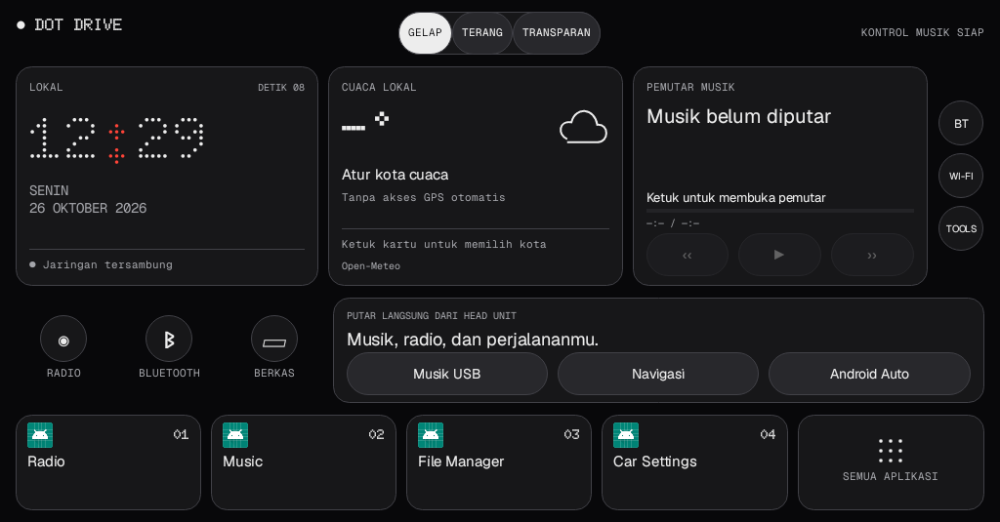

# Clean Your Headunit — 0.2 prototype

Aplikasi Android untuk memeriksa dan menonaktifkan aplikasi opsional di head unit. Ada mode langsung di perangkat dan mode pengendali dari HP, ditambah launcher DOT DRIVE. Semua memakai UI native; tanpa WebView untuk menampilkan antarmuka.

## Pasang langsung di head unit

Build modul `headunit`, lalu pasang `headunit-debug.apk` di head unit Android 8+. Aplikasi **Clean Your Headunit** bisa melakukan debloat lokal melalui Shizuku yang sudah berjalan dan diizinkan, atau root yang diberikan pengguna. Tidak perlu terminal emulator atau HP untuk menjalankan debloat setelah akses tersebut tersedia.

- Halaman utama menunjukkan model, versi Android yang dilaporkan sistem, API dan akses yang dipilih.
- **Gunakan Shizuku** meminta izin resmi dan menjalankan service shell melalui API Shizuku. **Gunakan akses root** meminta izin melalui `su`; root tidak dibuat oleh aplikasi.
- **Coba aktifkan ADB Wi-Fi** mencoba menyalakan ADB TCP port 8555. Root paling mungkin mengizinkan perubahan; shell Shizuku tetap mengikuti izin properti/SELinux firmware. Hasil perintah saja tidak dianggap bukti berhasil: aplikasi memeriksa balasan protokol ADB lokal.
- Listener lokal merespons bukan bukti koneksi HP berhasil: Wi-Fi, firewall dan otorisasi kunci ADB masih harus diuji dari HP.
- **Matikan ADB jaringan** mencoba menutup ADB TCP dan memeriksa port 5555/8555; USB debugging tidak diubah oleh tindakan ini.
- Tanpa root atau Shizuku aktif, aplikasi menyediakan pemeriksaan listener dan pintasan pengaturan; tidak menerobos izin sistem atau memasang komponen debugging yang tidak tersedia pada firmware. Tidak ada jaminan tetap aktif setelah reboot.
- Daftar kandidat dan proteksi dibagikan dengan aplikasi HP. Launcher dan keyboard aktif diperiksa lagi sebelum mutasi. Status hasil diperiksa, catatan disimpan sebelum menonaktifkan, dan ada **Aktifkan lagi**.
- Binary ini prototipe debug; akses root/Shizuku, aktivasi ADB dan UI belum diuji pada head unit fisik.

## DOT DRIVE 1.2.0 — dashboard harian



Preview native 1024×535 dengan ikon/aplikasi fixture, bukan screenshot head unit fisik. Cuaca dan metadata lagu dibiarkan kosong agar tidak menampilkan data tiruan. [Lihat tema terang](docs/images/dashboard-light.png).

Build modul `launcher`, lalu pasang `launcher-debug.apk`. Package `com.dotdrive.launcher` dipertahankan agar bisa memperbarui DOT DRIVE sebelumnya dengan tanda tangan yang sama. Pilih sebagai aplikasi Home melalui pengaturan sistem.

Desain mengikuti [Vibe Nothing UI](https://github.com/wangbh030722/vibe-nothing-ui-design): permukaan monokrom, jam Doto dot-matrix, teks Geist, label Geist Mono, bidang titik jarang di belakang kartu, radius kartu 8dp, tombol hitam-putih dan tanpa bayangan. Font lokal beserta lisensi OFL disertakan. Ini adaptasi native, bukan pemuatan HTML/CSS.

Dashboard baru memakai tiga kartu utama (jam/tanggal/jaringan, cuaca dan musik), pintasan Radio/Bluetooth/Berkas, panel sumber harian (Musik USB/Navigasi/Android Auto), empat favorit dan tray semua aplikasi. Android Auto tidak lagi ditempatkan sebagai favorit otomatis pertama; pilihan favorit pengguna sebelumnya dipertahankan.

Tema **Gelap**, **Terang** dan **Transparan** disimpan. Transparan memakai gambar pilihan melalui pemilih dokumen Android; tahan tombol tema Transparan atau buka Tools → Ganti wallpaper untuk mengganti gambar. Gambar diperkecil maksimal sisi 1280px lalu disimpan privat. Tidak ada efek blur, wallpaper video, WebView atau framework UI tambahan.

Tahan kartu favorit untuk mengganti aplikasinya. Pilihan tersimpan pada posisi yang dipilih; aplikasi yang hilang memakai saran otomatis. **Tools** menyediakan pengaturan Android, Clean Your Headunit, kontrol musik, wallpaper, kota cuaca dan pemutar pilihan.

Cuaca bersifat opsional: pilih kota secara manual, tanpa GPS. Pencarian kota dan koordinat kota pilihan dikirim melalui HTTPS ke [Open-Meteo](https://open-meteo.com/en/docs) / [Geocoding API](https://open-meteo.com/en/docs/geocoding-api). Data terakhir disimpan lokal dengan waktu pembaruan/cache; percobaan otomatis dibatasi 30 menit saat dashboard terlihat, dan fitur lokal tetap tersedia offline. Akses API gratis ini ditujukan untuk penggunaan nonkomersial; distribusi komersial memerlukan peninjauan ketentuan Open-Meteo. Atribusi sumber ditampilkan di kartu dan menu informasi cuaca.

Kontrol musik memakai sesi media Android. Akses notifikasi DOT DRIVE harus diberikan sendiri melalui pengaturan Android untuk membaca metadata/pemutar; service tidak membaca atau menyimpan isi pesan/notifikasi. Launcher tetap dapat dipakai tanpa izin ini. Radio/BT vendor yang tidak menerbitkan sesi media dapat dibuka lewat pintasan, tetapi judul lagu dan tombol transportnya tidak dijanjikan tersedia. Tombol transport hanya aktif bila sesi menyediakan aksi tersebut. Tidak ada lagu, cuaca atau data perjalanan tiruan.

Izin launcher: INTERNET dan ACCESS_NETWORK_STATE untuk cuaca/status jaringan, serta NotificationListenerService yang dilindungi izin sistem dan hanya aktif setelah persetujuan pengguna. Launcher tidak memerlukan root atau Shizuku.

Semua activity peluncur Android dan Android TV yang aktif ditampilkan tanpa daftar pengecualian nama paket, termasuk launcher sendiri dan launcher vendor bila aktif. Aplikasi yang dibekukan atau komponen yang dinonaktifkan tidak ditampilkan. Paket layanan tanpa activity peluncur tidak dibuatkan ikon palsu.

## Mode pengendali dari HP (0.1)

- **Clean Your Headunit** (`app`): pasang di HP Android 9+. Masukkan IP dan port ADB TCP head unit.
- **Headunit Helper** (`helper`): dipasang dari aplikasi HP melalui tombol **Pasang / perbarui Helper di head unit**, setelah ADB tersambung. APK Helper sudah dibundel di aplikasi HP. Bisa juga dipasang manual di head unit Android 8+. Memeriksa Shizuku lokal melalui API resminya.
- **Shizuku**: pasang dan jalankan di head unit, lalu berikan izin kepada Headunit Helper. Unduh dari https://shizuku.rikka.app/download/.

Alur: siapkan Shizuku dan koneksi ADB Wi-Fi head unit → hubungkan dari HP dan izinkan kunci ADB → pasang/buka Helper dari HP → berikan izin Shizuku di head unit → pemeriksaan Shizuku → pilih aplikasi → matikan. Tidak perlu memasang Shizuku di HP.

Shizuku di HP tidak memberikan akses ke head unit. Shizuku berjalan juga tidak membuktikan bahwa port ADB Wi-Fi terbuka. Aplikasi memeriksa handshake ADB, UID shell/root, identitas target dan status live Shizuku/izin Helper secara terpisah. Helper hanya menyediakan probe status baca-saja untuk UID shell/root/aplikasinya sendiri; bukan server shell terbuka.

## Batas versi pertama

- Mendukung ADB TCP klasik pada IP privat lokal, termasuk port 8555. Otorisasi menggunakan kunci RSA; lalu lintas ADB TCP klasik tidak memakai TLS. Belum mendukung pairing TLS Android 11+, USB OTG bootstrap, mDNS atau membuka port secara otomatis.
- Android 8–10 tanpa root memerlukan ADB yang sudah tersedia untuk aktivasi awal Shizuku. Pemasangan Shizuku saja tidak menyediakan jalur akses awal. Setelah reboot Shizuku mungkin perlu dijalankan lagi.
- Daftar vendor dibatasi keluarga 8227 dan berasal dari paket yang ditemukan pada unit pengguna. Ini bukan jaminan aman untuk setiap firmware 8227; pilihan awal kosong dan efek tiap paket dijelaskan. Perangkat lain hanya mendapat kandidat aplikasi umum yang terpasang.
- Tidak menyediakan diagnosis malware atau klaim peningkatan performa tanpa pengukuran.
- Google Play Services/GSF dilindungi karena microG juga dapat menggunakan nama paket tersebut. WebView/Chrome dilindungi agar sistem tidak kehilangan mesin web.
- Radio, CAN, MCU, Bluetooth, Shizuku, microG dan launcher/keyboard aktif dilindungi. Aplikasi tak dikenal tidak otomatis dimatikan.
- Tidak memasang launcher, mengganti Home, menghapus data, menghapus paket atau mengubah firmware.
- Aplikasi menonaktifkan dengan `pm disable-user --user 0` dan memeriksa hasil. Catatan disimpan sebelum perintah, terikat identitas perangkat. Jika koneksi terputus, hasil ditandai belum pasti; mutasi tidak diulang otomatis. Halaman **Aktifkan lagi** memakai catatan tersebut dan memeriksa status aktual.
- Kunci ADB HP disimpan di Android Keystore. Tidak ada akun, iklan atau telemetri aplikasi.
- APK prototipe memakai debug signing; belum rilis publik. Pemeriksaan unit/build tidak membuktikan koneksi HP–head unit fisik.

## Build

JDK 17 atau 21, Android SDK 34. Pada PowerShell:

```powershell
$env:ANDROID_HOME = "$env:LOCALAPPDATA\Android\Sdk"
.\gradlew.bat :app:assembleDebug :helper:assembleDebug :app:testDebugUnitTest
.\gradlew.bat :headunit:assembleDebug :launcher:assembleDebug :headunit:testDebugUnitTest :launcher:testDebugUnitTest
```

Hasil di `<modul>/build/outputs/apk/debug/`. Modul `headunit` adalah aplikasi langsung di head unit, `app` adalah pengendali HP, `helper` adalah pendamping pengendali HP, dan `launcher` adalah DOT DRIVE.

## Sumber dan lisensi

- Clean Your TV app contributors: `LICENSE` (MIT).
- Transport ADB turunan dadb: `ADB-NOTICE`, komentar lisensi Apache 2.0 di source dan `APACHE-2.0.txt`.
- Shizuku API/provider 13.1.5: https://github.com/RikkaApps/Shizuku-API (Apache 2.0).
- Panduan aktivasi: https://shizuku.rikka.app/guide/setup/.

Pengujian unit mencakup daftar proteksi, batas profil vendor, perintah yang diizinkan, penolakan injeksi perintah, autentikasi ADB, penempatan favorit, parsing cuaca/timezone, kondisi tanpa data, dan alur dashboard/tema/pemilih wallpaper. Render native Robolectric 1024×535 untuk preview memakai ikon dan daftar aplikasi pengujian; bukan screenshot perangkat fisik. Build/lint/unit test tidak menggantikan pengujian fisik root, Shizuku, jaringan, CAN bus, audio atau Home.
